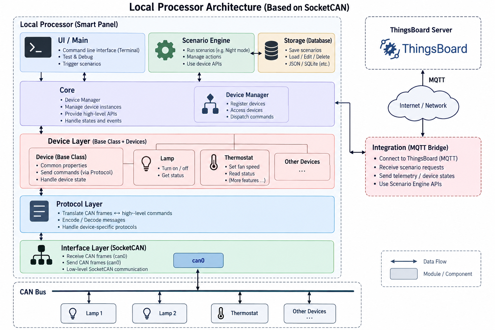
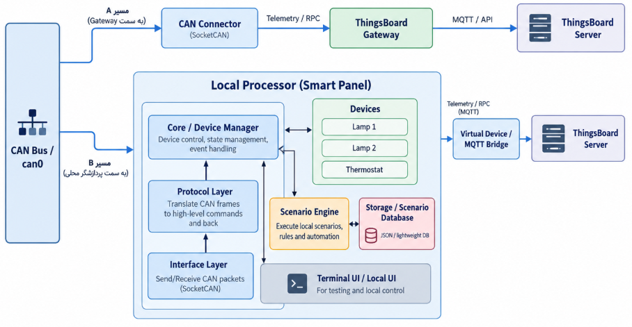

# Architecture 01 — Parallel Local Processing with SocketCAN

A direct-CAN, layered **Local Processor** prototype for a smart-home gateway. In this design, the Local Processor runs independently of ThingsBoard Gateway and opens its **own SocketCAN connection to `can0`**, while ThingsBoard Gateway can access the same CAN interface using a different socket.

This is **one of the four architectures I tested and evaluated during my internship**. I consider it a valid architectural option for settings that prioritize independent local control, rather than merely an unsuccessful step toward another design. I include my device models and scenario code, but **I intentionally replaced private CAN protocol constants with placeholders** in this public version. The placeholders are not the values I used for physical device tests.

[← Main repository](../../README.md) · [Architecture comparison](../../docs/architecture-comparison.md) · [Hardware bring-up](../../hardware/README.md)

## Architecture diagram



**Key idea:** SocketCAN allows multiple user-space sockets to attach to a Linux CAN interface. A local processor can therefore listen to device frames and send commands without asking the remote server or ThingsBoard Gateway to proxy every action.

```text
                                ThingsBoard Server
                                       ^
                                       | MQTT / remote management
CAN devices <--> can0 --> ThingsBoard Gateway / CAN Connector
                    |
                    +----> Local Processor (separate SocketCAN socket)
                              |-- Interface layer: raw CAN I/O
                              |-- Protocol layer: CAN decode / encode
                              |-- Device Manager + device classes
                              |-- Scenario Engine + JSON storage
                              |-- Terminal menu
                              `-- Separate MQTT ScenarioBridge
```

## Software layers

| Layer | Included implementation | Responsibility |
|---|---|---|
| CAN interface | [`canbus/can_interface.py`](canbus/can_interface.py) | Bind an `AF_CAN` socket to `can0`; transmit/receive classic CAN frames |
| Protocol translation | [`canbus/can_protocol.py`](canbus/can_protocol.py) | Decode CAN identifiers, registers, and data; build outgoing messages |
| Device models | [`devices/`](devices/) | Base `Device`, six lamp channels, thermostat prototype |
| Device orchestration | [`core/device_manager.py`](core/device_manager.py) | Register device objects and route decoded messages |
| Scenarios | [`core/scenario_engine.py`](core/scenario_engine.py) | Execute ordered lamp/thermostat actions |
| Persistent scenario definitions | [`storage/json_storage.py`](storage/json_storage.py) | JSON CRUD for named scenarios |
| Local UI | [`ui/scenario_menu.py`](ui/scenario_menu.py), [`test.py`](test.py) | Terminal-based device and scenario controls |
| Remote bridge | [`integrations/thingsboard/scenario_bridge.py`](integrations/thingsboard/scenario_bridge.py) | MQTT interface for scenario requests and catalog data |

`main.py` is empty in this source snapshot. I used `test.py` as the interactive prototype entry point.

## Data flow

### Receiving a CAN message

1. `CANInterface.receive()` reads a raw CAN frame from `can0`.
2. `CANProtocol.decode_frame()` interprets the CAN ID, operation, and data fields.
3. `DeviceManager.handle_message()` routes the resulting event to an appropriate lamp/thermostat model.
4. Device objects update local state, which the terminal interface and scenario logic can access.

### Executing a local scenario

1. A user selects a scenario such as `Night` from the local menu.
2. `ScenarioEngine` resolves actions such as `turn_off` for lamp channels or `set_sp` for the thermostat.
3. Device methods produce device-specific operations through the protocol and interface layers.
4. CAN frames reach the physical network **without a round trip through ThingsBoard**.

Example, adapted from the sanitized source fixtures:

```json
{
  "Night": {
    "actions": [
      { "device": "lamp", "number": 1, "action": "turn_off" },
      { "device": "lamp", "number": 2, "action": "turn_off" },
      { "device": "thermostat", "action": "set_sp", "value": 22.0 }
    ]
  }
}
```

The actual JSON storage file uses a top-level `"scenarios"` object, as shown in [`examples/scenarios.json`](examples/scenarios.json).

## Development setup

**Prerequisites:** Linux with a working `can0`, Python 3.11/3.12 (development assumption), access to a CAN test bus, and `paho-mqtt` if using the independent ThingsBoard scenario bridge. See the [hardware README](../../hardware/README.md) to configure the MCP2515 adapter.

From this architecture directory:

```bash
python3 -m venv .venv
source .venv/bin/activate
pip install -r requirements.txt

# Optional: initialize the example scenarios. The storage module will
# otherwise create an empty JSON database when first used.
cp examples/scenarios.json storage/data.json

# For the separate MQTT scenario bridge, fill in and export credentials.
cp ../../config/01-parallel-socketcan/.env.example .env
# Edit .env with your own virtual-device endpoint and access token.
set -a; . ./.env; set +a
```

**Before attempting device control**, restore the intentionally anonymized hardware-specific values in [`canbus/can_protocol.py`](canbus/can_protocol.py): operation bit positions, device ID mask, value limits, CAN payload indexes, and the correct device register map. I deliberately do **not** publish my original private device values. Do not invent or guess them; use your private protocol documentation before testing any physical equipment.

After validating the protocol against your **own test CAN device**:

```bash
python3 test.py
```

`test.py` is an interactive manual demo, **not** an automated passing test. It creates the local CAN interface, device objects, scenario engine, and MQTT bridge, then runs terminal menus. It assumes both the physical bus and the configured ThingsBoard endpoint exist.

## Engineering evaluation: strengths and limitations

**What I evaluated:** multiple SocketCAN consumers on `can0`, direct local lamp control, thermostat functions, and execution of local scenarios. I observed feasibility of the *approach* on my test setup; this does not mean the anonymized public protocol can operate real hardware without device-specific values.

**Strengths**
- Independent control of CAN devices even when the remote ThingsBoard server is not reachable.
- A relatively lightweight local processing route with explicit interface, protocol and device layers.
- Fewer dependencies on internal ThingsBoard Gateway modifications.

**Limitations**
- The Local Processor and Gateway each interpret the CAN protocol, increasing maintenance and consistency work.
- Its separate MQTT bridge and direct CAN route introduce multiple paths that must be coordinated.
- Concurrent command writers need a policy for avoiding contradictory device operations.



**Organizational fit:** consider this approach where direct, independent CAN access and lightweight local processing are priorities **and** the organization accepts duplicated decoding and communication paths. If centralized CAN ownership is mandatory, compare architectures 02–04.

## Known limitations

- `canbus/can_protocol.py` contains **intentional redactions**. It is not executable for meaningful CAN protocol operations until private device-specific values are supplied; it should not be interpreted as an abandoned or unfinished implementation. I retained valid Python framing using the Linux classic `can_frame` layout, while leaving the application protocol values intentionally anonymized.
- The six lamp classes and thermostat are tightly coupled to the project-specific CAN device/register semantics.
- `integrations/thingsboard/tb_bridge_test.py` is incomplete: it constructs the MQTT bridge without the required `scenario_engine` argument.
- The MQTT bridge reads its token from environment variables rather than a committed value. The example token is a nonfunctional placeholder; I have not included real deployment credentials.
- No automated device-in-the-loop or outage/recovery test is included.

See [Engineering notes](../../docs/engineering-notes.md) for additional version, security, and integration limitations.
