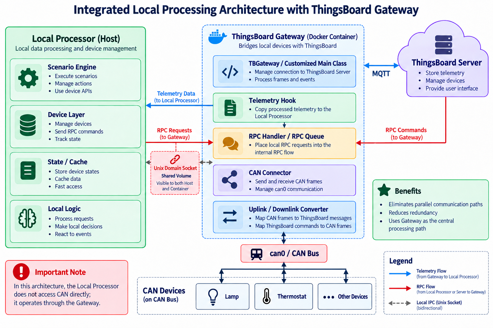

# Architecture 02 — Gateway-Integrated Local Processing

In this architecture, **I evaluated a Gateway-centered local-processing design**. I kept **ThingsBoard Gateway as the only process accessing the physical CAN network**. My separate host-side **Local Processor** obtains high-level device state and sends commands through the gateway rather than opening a second SocketCAN socket. The architecture adds a Unix-domain-socket IPC interface and integrates local commands with the existing gateway RPC pipeline.

> **Source scope:** I include my host-side Local Processor code and a **modified upstream ThingsBoard Gateway service file**. The repository does not contain a complete Gateway installation. My telemetry cache also requires a CAN Connector hook described below. I have not validated this published snapshot end to end against a deployed Gateway image.

[← Main repository](../../README.md) · [Architecture comparison](../../docs/architecture-comparison.md) · [Engineering notes](../../docs/engineering-notes.md)

## Architecture



```text
          Physical CAN devices
                  |
              CAN / can0
                  |
    ThingsBoard Gateway (Docker)
         |                 |
  CAN Connector       MQTT / ThingsBoard
         |
    CAN converters
         |
   Converted telemetry / local RPC handling
         |
  GatewayManager over /tmp/gateway (Unix socket)
         |
  Local Processor (host)
         |-- Device Manager / state cache
         |-- Scenario Engine + JSON scenario storage
         `-- Terminal UI and scenario command service
```

**The key distinction from architecture 01:** the local application no longer interprets raw CAN frames or duplicates their conversion. It uses gateway-level concepts such as device name, state and RPC method.

## Source code included

| File or directory | Responsibility |
|---|---|
| [`gateway_patch/tb_gateway_service.py`](gateway_patch/tb_gateway_service.py) | **Modified upstream ThingsBoard Gateway service** with a `GatewayManager`, exposed local device APIs, `send_local_rpc(...)`, device-state cache, and scenario-command forwarding. This is the only bundled copy of an upstream Gateway core source file. |
| [`gateway/gateway_client.py`](gateway/gateway_client.py) | Connects to the gateway's manager proxy at a shared Unix socket and calls `get_local_devices`, `get_device_data`, `get_available_connectors`, and `send_local_rpc`. |
| [`devices/`](devices/) | Device models and a Device Manager that use the gateway client. |
| [`scenario/scenario_engine.py`](scenario/scenario_engine.py) | Translates a named scenario into device commands. |
| [`scenario/scenario_storage.py`](scenario/scenario_storage.py) | Scenario JSON persistence. |
| [`scenario/scenario_rpc_server.py`](scenario/scenario_rpc_server.py) | A second IPC endpoint for scenario-management requests (`/tmp/smart_panel`). |
| [`terminal/`](terminal/) | Host-side local terminal interface. |
| [`examples/scenarios.json`](examples/scenarios.json) | Sanitized example scenarios, **not real deployment data**. |

The modified Gateway service contains **ThingsBoard upstream code**; I retained its original copyright and Apache-2.0 header and marked my changes. The full [Apache-2.0 license](gateway_patch/LICENSE-APACHE-2.0.txt) governs that file. My separately authored project code is under the root [MIT license](../../LICENSE), as clarified in the [NOTICE](../../NOTICE).

## Data and command paths

### 1. CAN telemetry to the Local Processor

1. A CAN frame reaches the Gateway's original CAN Connector.
2. The connector's Uplink Converter decodes the frame into ThingsBoard-style converted data.
3. The Gateway exposes **`update_local_data(converted_data)`**, which stores the latest telemetry and attributes by device name.
4. A host-side `GatewayClient` reads device state using **`get_device_data(device_name)`**; device management and scenarios work on structured data, not raw CAN frames.
5. The normal gateway uplink to ThingsBoard continues separately.

**Integration boundary:** I implemented `update_local_data` in the modified service, but **the service does not call that method automatically**. In my integrated prototype I added a call from the CAN Connector after successful conversion, before normal storage forwarding. I did not bundle a second copy of the upstream CAN Connector. A deployment needs the equivalent hook in its **version-matched** connector; without it the local state cache remains empty. This is a functional integration dependency, not a hidden credential.

### 2. Local RPC to CAN device

1. The Scenario Engine expands a high-level request (e.g., *Night*) into per-device methods and parameters.
2. The host-side `GatewayClient` calls `send_local_rpc(content)` via the Gateway manager.
3. The modified Gateway queues the command in its normal RPC-to-device pipeline.
4. The existing CAN Connector's server-side RPC handler and Downlink Converter build the required CAN command.

The same gateway service file also contains code to forward `getScenarios`, `runScenario`, and related methods to the optional scenario IPC service on `/tmp/smart_panel`. These are experimental additions in the supplied snapshot; do not assume they exist in stock upstream releases.

## Two local IPC channels

| Channel | Default shared path | Direction | Environment key |
|---|---|---|---|
| Gateway manager | `/tmp/gateway` | Local Processor → Gateway API | `GATEWAY_AUTHKEY` |
| Scenario command listener | `/tmp/smart_panel` | Gateway → Local Processor's scenario service | `SMART_PANEL_AUTHKEY` |

In my design, the gateway runs in a container and the Local Processor runs on the Linux host. Each Unix socket path **must refer to the same filesystem location** in both processes (I used a shared `/tmp` mount during prototyping). For a hardened environment, use a dedicated shared directory with minimal permissions, rather than mounting all of `/tmp`.

I use **required environment variables** (`GATEWAY_AUTHKEY` and `SMART_PANEL_AUTHKEY`) for IPC authentication instead of embedding literal values. The `.env.example` contains placeholders only. Socket paths can also be overridden by environment variables. This `multiprocessing` IPC design relies on trusted peers and filesystem permissions; its authentication is not a reason to expose the sockets to untrusted users.

## Running a compatible installation

**Prerequisites:** a ThingsBoard Gateway version compatible with this customized `tb_gateway_service.py`; a working Linux `can0`; suitable CAN Connector and converters; Docker or an equivalent process environment; Python for the host client; and shared Unix-socket paths.

I originally worked with a **`thingsboard/tb-gateway:3.8.3`** base in this approach; the Scenario Connector Compose example uses **3.8.4**. These releases are not interchangeable for a whole-file core patch. I have not verified drop-in compatibility of the published modified service against either image; any deployment needs a matched dependency and integration test.

For the host-side environment:

```bash
cd architectures/02-gateway-integrated
cp ../../config/02-gateway-integrated/.env.example .env
# Put UNIQUE, private IPC keys in .env; use the same values inside the Gateway container.
set -a; . ./.env; set +a
# Only after your patched Gateway manager is available on the shared Unix socket:
python3 main.py
```

If the separate scenario management service is required:

```bash
set -a; . ./.env; set +a
python3 -m scenario.scenario_rpc_server
```

The Gateway container must receive `GATEWAY_AUTHKEY` and `SMART_PANEL_AUTHKEY` too (e.g., via its own non-committed environment file or Compose `environment:` mapping), and must share the Unix socket locations. **This source file is a version-sensitive customization, not an automatic Gateway patch installer.** A running deployment must supply it through a controlled, version-matched integration and include the CAN telemetry hook.

To use the example scenario storage, copy the sanitized fixture to `scenario/data.json`. Runtime storage files are ignored by Git.

## Engineering evaluation: strengths and limitations

**What I evaluated:** exposing converted telemetry to local logic, injecting local device RPC into Gateway's existing downlink path, and using Unix-domain-socket IPC between a Dockerized Gateway and my host Local Processor.

**Strengths**
- Centralizes CAN decoding and command conversion in a single Gateway-controlled pipeline.
- Allows the Local Processor to work with device states and RPC abstractions rather than raw CAN frames.
- Reuses the existing CAN Connector for actual device communication.

**Limitations**
- Telemetry hooks, the local manager interface and RPC handling depend on customized upstream Gateway code.
- Those changes must be maintained and rechecked when Gateway versions change.
- Host/container IPC requires explicit shared-socket paths, permissions and authentication.

**Organizational fit:** consider this approach if a team values a **single CAN authority** and is willing to maintain its own customized ThingsBoard Gateway distribution. Teams that need to avoid changing Gateway core code may prefer to investigate [03 — Scenario Connector](../03-scenario-connector/README.md); organizations with stronger native ThingsBoard expertise should also compare [04 — Edge](../04-thingsboard-edge/README.md).
