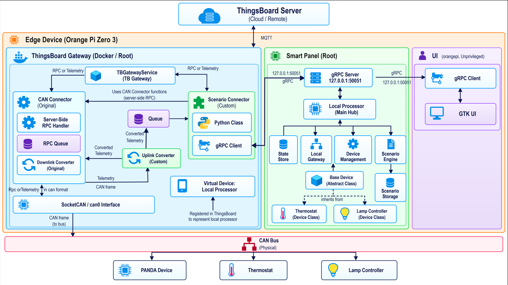
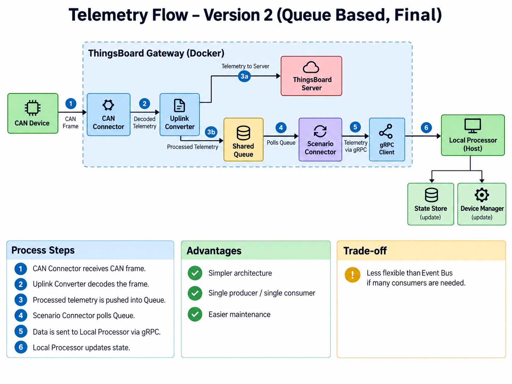
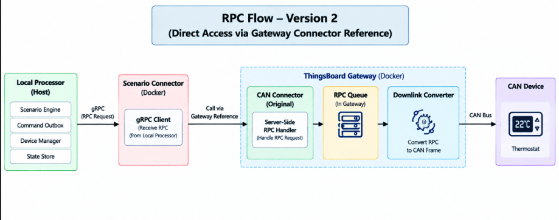

# Architecture 03 — Scenario Connector + gRPC Local Processor

A connector-based smart-home architecture that keeps **ThingsBoard Gateway** in charge of physical CAN communication and places **local scenario orchestration** in a separate **Smart Panel / Local Processor** service. A custom **Scenario Connector** bridges these two components without requiring the Local Processor to decode or transmit CAN frames directly.

I tested this as **one of four alternative architectures**, not as an automatic winner for every deployment. I include the main experimental components: CAN converters, a Scenario Connector implementation, a host-side gRPC server, scenario logic/storage, and GTK4 UI code. **The presence of more source files here is not evidence that this approach performs better than the others.**

> **Deployment status:** This is a development reference. I included a small replacement for a missing shared telemetry queue helper and describe its behavior below. I have not rerun the complete CAN, ThingsBoard, Docker, and UI integration test on this packaged snapshot.

[← Main repository](../../README.md) · [Architecture comparison](../../docs/architecture-comparison.md) · [Hardware bring-up](../../hardware/README.md)

## Complete system architecture



The system consists of three cooperating execution domains:

| Component | Runs where | Responsibility |
|---|---|---|
| **ThingsBoard Gateway** | Docker container on the Orange Pi / Linux host | MQTT uplink to ThingsBoard; physical CAN Connector; RPC-to-CAN conversion; runs Scenario Connector |
| **Smart Panel / Local Processor** | Linux host Python process | Device Manager, State Store, Scenario Engine, scenario storage, and command outbox |
| **GTK4 UI / terminal UI** | Linux user session on the host | Displays devices/scenarios and sends requests to the Local Processor through gRPC |

**Terminology:** *Smart Panel* is the wider local system; *Local Processor* orchestrates operations; *Scenario Engine* expands scenario definitions into individual device commands. The graphical interface does not execute scenarios or access the CAN bus.

## Engineering evaluation: strengths and limitations

**What I evaluated:** a Scenario Connector communicating with a host-side Local Processor over gRPC, CAN telemetry forwarding, local RPC dispatch, a transition from Event Bus to a queue, and a GTK-based UI.

**Strengths**
- Gateway remains responsible for CAN access and conversion, while scenario orchestration is a separate service.
- Module boundaries are clearer than in an approach that patches the core Gateway service extensively.
- gRPC can serve both connector operations and a separate local user interface.

**Limitations**
- Requires multiple cooperating parts (Gateway, connector, local process, queue, and gRPC), including monitoring and reconnection logic.
- Integration still relies on specific Gateway / CAN Connector API behavior across versions.
- The telemetry queue is in process, not durable; the reconstructed helper in this public snapshot is not a substitute for production delivery/retry guarantees.

**Organizational fit:** consider this architecture when **local application modularity and extensibility** outweigh the extra operational components. Teams prioritizing lower-level independence may compare [01 — Parallel SocketCAN](../01-parallel-socketcan/README.md); teams seeking native ThingsBoard rules with sufficient resources may evaluate [04 — Edge](../04-thingsboard-edge/README.md).

## Uplink: CAN telemetry to ThingsBoard and Smart Panel

```text
CAN devices
    |
Linux SocketCAN / can0
    |
ThingsBoard CAN Connector
    |
SmartPanelCanUplinkConverter (CAN -> high-level telemetry)
    |                              |
    | normal gateway uplink       `-> CanScenarioBridge (in-process FIFO queue)
    v                                           |
ThingsBoard server                         ScenarioConnector
                                                |
                                        gRPC PushTelemetry
                                                |
                                     Local Processor (host)
                                                |
                                     State Store / Device Manager
```

The CAN Uplink Converter calls the standard byte-based converter first. It then **copies the converted telemetry**, not the raw CAN frame, into an in-process queue consumed by Scenario Connector. The same converted data can continue through the normal ThingsBoard Gateway uplink path.



I initially experimented with an **Event Bus**, then replaced its publish/subscribe machinery with a simpler queue for the single-producer/single-consumer telemetry path. Old Event Bus files remain in the source snapshot as reference code, but are not the intended active route.

## Downlink: local scenario to CAN device

```text
GTK4 / terminal / local client
             |
         gRPC request
             |
     Local Processor
             |
   Scenario Engine: Night
             |
    Device-specific actions
             |
       Command Outbox
             |
      gRPC PullCommands <--- ScenarioConnector polls local processor
             |
 ScenarioConnector resolves the original CAN Connector
             |
    CAN Connector server_side_rpc_handler(...)
             |
        Downlink Converter
             |
        SocketCAN / can0
             |
      Physical CAN device
```

The Local Processor produces **high-level commands** with a device, method, and parameters. Scenario Connector passes them through the existing CAN Connector RPC handler; CAN frame encoding stays in the gateway. The implementation assigns **negative request IDs** to locally generated RPC requests to distinguish them from ordinary positive-ID server requests and prevent mixing up their response handling.



## Directory guide

```text
03-scenario-connector/
├── README.md
├── requirements-host.txt
├── can/
│   ├── smart_panel_can_uplink_converter.py
│   └── smart_panel_can_downlink_converter.py
├── smart_panel_shared/
│   └── can_scenario_bridge.py     # Reconstructed, process-local queue helper
├── scenario_connector_files/
│   ├── scenario_connector.py     # Active custom connector class
│   ├── smart_panel_ui.py         # GTK4 user interface
│   ├── smart_panel_core/
│   │   ├── grpc_server.py        # Host-side gRPC server
│   │   ├── grpc_client.py        # Client used by connector/UI
│   │   ├── local_processor.py
│   │   ├── local_gateway.py      # High-level command gateway / outbox
│   │   ├── command_outbox.py
│   │   ├── state_store.py
│   │   ├── devices/
│   │   └── scenario/
│   │       ├── scenario_engine.py
│   │       └── scenario_storage.py
│   └── ...                       # Earlier experimental implementations
└── examples/
    ├── scenarios.json
    └── devices_registry.json
```

### Configuration files (centralized at repository root)

Deployment files are **not duplicated inside the architecture's source folder**. They are maintained under [`../../config/03-scenario-connector/`](../../config/03-scenario-connector/):

- [`gateway/tb_gateway.json`](../../config/03-scenario-connector/gateway/tb_gateway.json): ThingsBoard connectivity and registered CAN and Scenario Connectors.
- [`gateway/padnaCanGateway.json`](../../config/03-scenario-connector/gateway/padnaCanGateway.json): lamp, thermostat, and blind mappings to CAN telemetry/RPC; several protocol fields are deliberately anonymized.
- [`gateway/scenarioConnector.json`](../../config/03-scenario-connector/gateway/scenarioConnector.json): `canConnectorName`, local gRPC endpoint (`127.0.0.1:50051`), polling and logging settings.
- [`.env.example`](../../config/03-scenario-connector/.env.example): gateway endpoint and credentials template.
- [`docker-compose.yml`](../../config/03-scenario-connector/docker-compose.yml): Linux host-network deployment using the project's `thingsboard/tb-gateway:3.8.4` reference image and updated relative source mounts.

See the [central configuration guide](../../config/README.md) before deployment.

### Earlier implementations kept for reference

I also retain `scenario_connector_files/custom_can_connector.py`, `scenario_connector_files/smart_panel_can_uplink_converter.py`, `smart_panel_core/event_bus.py`, and `smart_panel_core/events.py`. These are earlier **Event Bus / custom CAN connector** variants, not the final active path described above. I retained them to show how the design evolved.

## Prerequisites

- Linux host (I evaluated this on an **Orange Pi Zero 3**) with kernel CAN support and a configured `can0`.
- A CAN transceiver/adapter that actually communicates with your test devices. See [Hardware and SocketCAN](../../hardware/README.md).
- Python 3.11/3.12, `grpcio`, and `protobuf` on the host.
- Docker + Docker Compose on Linux, and a reachable ThingsBoard server with **your own gateway access token**.
- For the graphical UI: GTK **4.0** and PyGObject (`python3-gi` plus the distribution's GTK4 introspection package), a graphical session, and a **non-root** desktop user.

The host-side gRPC service is **not a database or broker**; it runs the Local Processor and stores scenario definitions in local JSON. The Gateway container and the UI talk to it over loopback.

## Setup and startup

All commands below assume you are in `architectures/03-scenario-connector` unless a `cd` command says otherwise. They are **starting-point instructions**, not a claim of successful hardware integration on your own device.

### 1. Confirm the physical CAN interface

Follow the [MCP2515 / SocketCAN guide](../../hardware/README.md) and verify `ip -details link show can0` succeeds, with the correct bitrate and wiring. The GPIO/SPI pins and Device Tree overlay are board- and kernel-specific.

### 2. Install host-side Python dependencies

```bash
python3 -m venv --system-site-packages .venv
source .venv/bin/activate
pip install -r requirements-host.txt
```

For GTK4 on Debian/Ubuntu-family hosts, the system packages typically include:

```bash
sudo apt install python3-gi gir1.2-gtk-4.0
```

The `--system-site-packages` virtual environment option allows OS-provided PyGObject/GTK bindings to be visible to the Python interpreter.

### 3. Optionally seed example local data

Runtime databases are not committed. The Local Processor will create an empty scenario file if it is missing. If you prefer the sample `Night` and `day` scenarios and device registry from this repository:

```bash
cp examples/scenarios.json scenario_connector_files/smart_panel_core/scenario/scenario_data.json
cp examples/devices_registry.json scenario_connector_files/devices_registry.json
```

The registry uses a **relative path** (`devices_registry.json`) by default. The commands below launch the service from `scenario_connector_files` so that this path is consistent. Keep real user scenarios and device registries out of Git.

### 4. Start the Local Processor gRPC service on the Linux host

```bash
cd scenario_connector_files
python3 -m smart_panel_core.grpc_server
```

The server binds to **`127.0.0.1:50051`**. Leave this process running and open a **separate terminal** for the gateway setup. Binding to loopback is intentional; the provided service uses an insecure (non-TLS) gRPC channel.

### 5. Configure and start the ThingsBoard Gateway container

From a **new shell at the repository root**, enter the centralized configuration directory:

```bash
cd config/03-scenario-connector
cp .env.example .env
# Edit .env: your ThingsBoard host/port, gateway access token and CAN interface.
# Inspect gateway/tb_gateway.json and the other anonymized Gateway settings.
docker compose --env-file .env config     # inspect rendered configuration
docker compose --env-file .env up -d

docker compose --env-file .env logs -f tb-gateway
```

The Compose reference uses **host networking** and bind-mounts:

- `./gateway/` to the Gateway configuration directory.
- `../../architectures/03-scenario-connector/can/` to the CAN extension directory.
- `../../architectures/03-scenario-connector/scenario_connector_files/` to the custom connector extension directory.
- `../../architectures/03-scenario-connector/smart_panel_shared/` to a shared importable extension directory used by the converter and Scenario Connector.

**Compatibility checks:** confirm that the ThingsBoard Gateway image loads the custom converter and `ScenarioConnector` classes from these mounts. Its internal connector APIs and custom extension paths can vary by version. The configuration file `tb_gateway.json` also contains placeholder connection fields; ensure the intended environment overrides are actually applied in your deployed image.

### 6. Use the terminal or GTK4 UI as an unprivileged user

From `scenario_connector_files`, with the host Python environment active:

```bash
# Simple text command interface
python3 -m smart_panel_core.terminal_ui

# Or, from the same directory and an active GTK display session
python3 smart_panel_ui.py
```

The UI uses `LocalProcessorGrpcClient` and never directly opens the CAN device. To experiment with full-screen UI, the source checks the `SMART_PANEL_FULLSCREEN=1` environment variable. For headless development, I used VNC over an SSH tunnel; no VNC server configuration is included in this repository.

## Programmatic gRPC example

With the host gRPC server running, from inside `scenario_connector_files`:

```python
from smart_panel_core.grpc_client import LocalProcessorGrpcClient

client = LocalProcessorGrpcClient(target="127.0.0.1:50051")
print(client.get_devices())
print(client.get_scenarios())
print(client.run_scenario("night"))  # Requires a seeded/created scenario
client.close()
```

The implementation uses **gRPC unary methods with `google.protobuf.StringValue` carrying JSON strings**; it does not ship a generated project-specific `.proto` file. API methods include telemetry push, device/state queries, scenario CRUD, scenario execution, and command polling.

## Verifying the integration

Use the ThingsBoard and Linux logs to check each handoff separately:

1. `can0` receives real frames from your test device.
2. CAN Connector and Uplink Converter decode the expected device and telemetry names.
3. `CanScenarioBridge` enqueues converted telemetry, and Scenario Connector forwards it through gRPC.
4. Local Processor updates `StateStore` and `DeviceManager`.
5. An example `night` request creates device actions and places commands into the outbox.
6. Scenario Connector pulls commands and routes them through the original CAN Connector's RPC handler.
7. Devices respond, and ThingsBoard telemetry reflects the new state when cloud connectivity exists.

The queue-only test can be run from the repository root:

```bash
python3 -m unittest discover -s tests -v
```

This is **not** a replacement for an end-to-end device-in-the-loop test.

## Design caveats and security

- **Shared helper:** `smart_panel_shared/can_scenario_bridge.py` is a small, bounded FIFO replacement created to satisfy the APIs used by the converter and connector. I have validated its basic queue behavior with unit tests but not with physical CAN hardware. It operates only when the converter and Scenario Connector run **inside the same Python process**. It is not a durable queue; messages can be dropped when full or lost on process restart.
- **Version coupling:** the connector locates the original CAN Connector by name and invokes its server-side RPC handler. That is less invasive than modifying the main Gateway class, but can still depend on Gateway internals and configuration conventions.
- **RPC namespace:** negative local RPC IDs are an implementation convention; verify conflict handling and responses with the actual ThingsBoard Gateway release.
- **Credentials:** the Compose template reads `${TB_GW_ACCESS_TOKEN}` from a local, ignored `.env` file. I do not include a working gateway token or private device protocol values. Use a dedicated test token and restrict access to the local environment file.
- **Local gRPC security:** `127.0.0.1:50051` is a trusted-host development endpoint without TLS/authentication. Do not forward or expose it on an untrusted interface without changing the design.
- **Real deployment:** no live physical CAN, GTK4 display, or ThingsBoard network setup was available to validate all steps as an integrated system.

For version assumptions, security boundaries, and unresolved integration items, see my [engineering notes](../../docs/engineering-notes.md).
