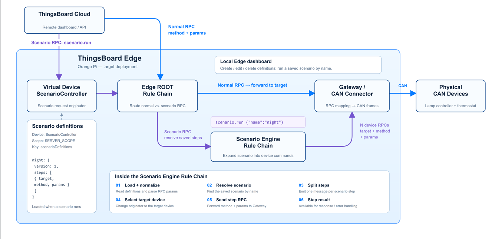

# Architecture 04 — ThingsBoard Edge and Local Rule Chains

**I designed and evaluated this architecture during my internship, but its deployment files are not included here.** I experimented with scenario-processing Rule Chains, runtime tuning, desktop trials, and running ThingsBoard Edge alongside Gateway on an Orange Pi Zero 3. **I did not achieve stable joint operation on that board**. The missing Rule Chain exports do not mean that I only proposed the architecture on paper.

I evaluated this as **one of four alternatives**, with benefits and constraints that differ from the Python Local Processor designs. It may suit other organizational environments, particularly when adequate hardware resources and ThingsBoard operational expertise are available. It is not presented as universally better or worse.

[← Main repository](../../README.md) · [Architecture comparison](../../docs/architecture-comparison.md) · [Organizational selection guide](../../docs/organization-selection-guide.md)

## Conceptual architecture



```text
                           Remote ThingsBoard Server
                                 (when connected)
                                         ^
                                         |
                          Local ThingsBoard Edge
                     +--------------------------------+
                     | Root Rule Chain                |
                     |   |                            |
                     |   +-- Direct device RPC ------+----+
                     |   |                                 |
                     |   +-- Virtual Scenario Controller   |
                     |             |                       |
                     |      Scenario Engine Rule Chain     |
                     |             |                       |
                     |      Per-device RPC ----------------+
                     +-------------------------------------+
                                                           |
                                                ThingsBoard Gateway
                                               CAN Connector/converters
                                                           |
                                                    SocketCAN / can0
                                                           |
                                                    Physical CAN devices
```

Unlike architectures 01–03, named scenario definitions and actions are processed through **ThingsBoard Edge Rule Chains**, rather than a separate Python Scenario Engine. The Gateway keeps responsibility for CAN frames and the device RPC downlink. This describes the **design I evaluated**, not an exported deployable Edge configuration.

## Scenario execution flow I evaluated

1. Maintain scenario definitions as **server-side attributes** associated with a virtual **Scenario Controller** device; each action specifies target device, RPC method and parameters.
2. A widget or client requests a named scenario such as `night` without transmitting all its implementation details.
3. A **Root Rule Chain** routes direct-device RPC along the ordinary Gateway path, and scenario-related requests to a **Scenario Engine Rule Chain**.
4. The Scenario Engine Rule Chain loads the definition, expands each action into a device-targeted request, changes the originator when necessary, and invokes the RPC Request flow.
5. The Gateway's CAN Connector/downlink converter generates the corresponding CAN frames. Device telemetry flows back through the Gateway to the local ThingsBoard environment and, when available/configured, the central server.

## Engineering evaluation: strengths and limitations

**Strengths**
- Uses **ThingsBoard's native Rule Chain model** for scenario routing, decomposition, and device-specific RPC.
- Avoids a separate bespoke Python Local Processor / Scenario Engine in the intended design.
- Fits an organization that already manages ThingsBoard workflows and can dedicate sufficient resources to an Edge installation.

**Limitations**
- On my Orange Pi Zero 3 test setup, I could not achieve reliable Edge + Gateway + supporting-service operation, even after tuning.
- I observed substantial RAM pressure: an initial Edge estimate of roughly 1.3 GB against about 700 MB free on the tested board; in a 600 MiB-restricted container trial, usage reached approximately 595 MiB before accounting for other services.
- Swap pressure, severe system slowdown, crashes and manual resets occurred in the board experiments, including trials without Docker.
- An organization adopting this design must provision and validate the Edge runtime and its rule-engine operations on actual deployment hardware.

**Organizational fit:** consider this design when **native platform automation is a priority** and a host with adequate RAM/CPU is available. It is not a good assumption for a memory-limited board until a **stable feasibility test** passes. A more resource-constrained deployment may choose to evaluate one of the Python Local Processor alternatives, but no universal ranking is implied.

## Test outcome versus source availability

| Question | Status |
|---|---|
| Did I design and test this alternative? | **Yes** — I experimented with Rule Chains, scenario attributes, and Edge installation/resource constraints. |
| Did Edge and Gateway run stably together on the tested Orange Pi Zero 3? | **No** — not under the tested hardware and tuning conditions. |
| Are exported Rule Chains, source files, and Edge deployment configs included? | **No** — this repository documents the tested approach but does not contain those exports. |
| Does this rule out Edge for other organizations? | **No** — hardware capacity, operational requirements and platform expertise can differ. |

## Repository scope

I include this engineering evaluation rather than fabricate deployment artifacts that are not part of the published source. No Edge Rule Chain exports, credentials, or runnable Edge configuration are bundled. The [central configuration layout](../../config/README.md) covers the other implemented alternatives.

For organizational selection, see the [four-way comparison](../../docs/architecture-comparison.md) and [selection guide](../../docs/organization-selection-guide.md).
