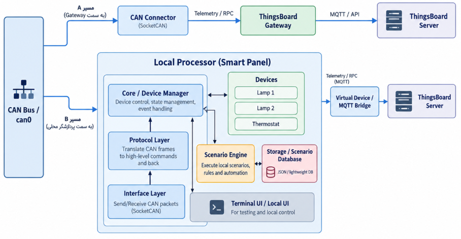
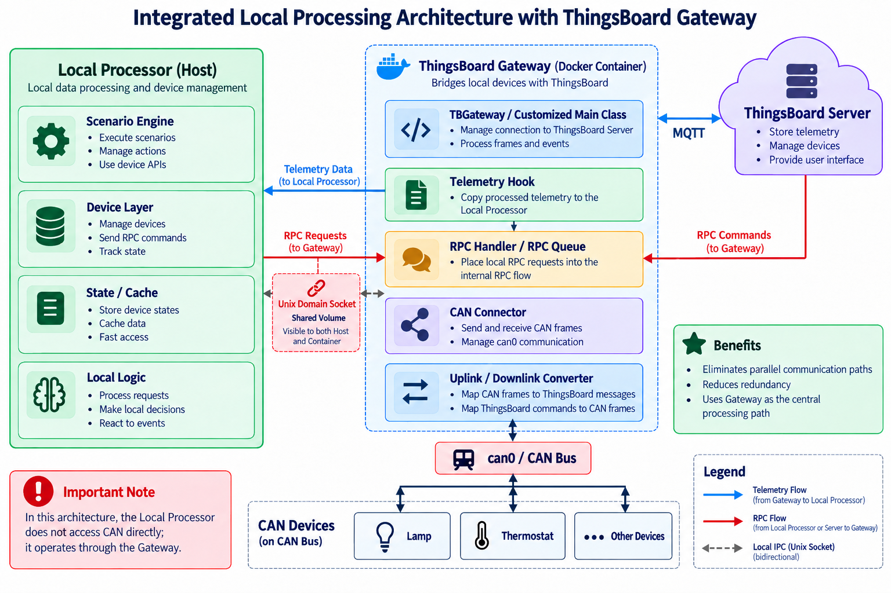
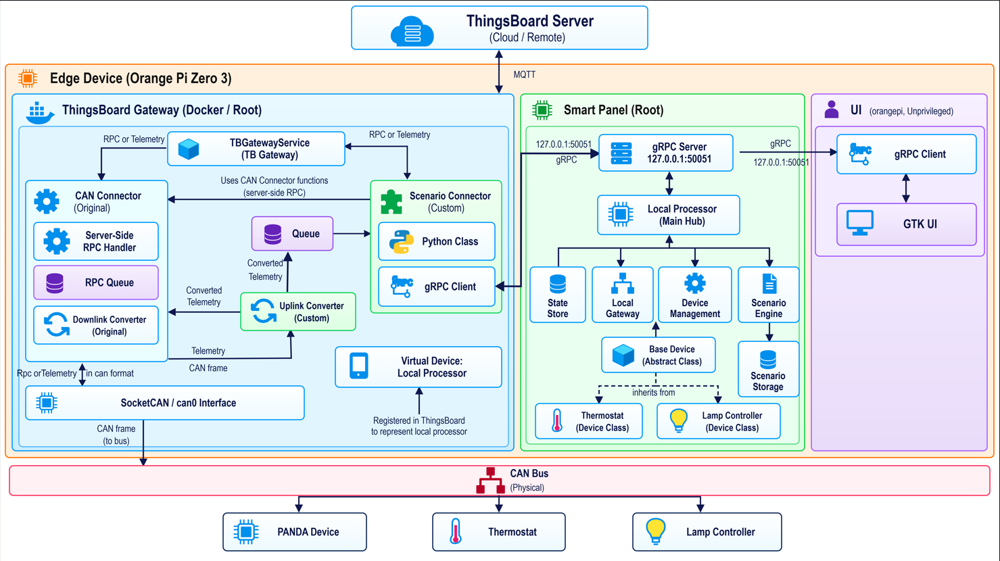
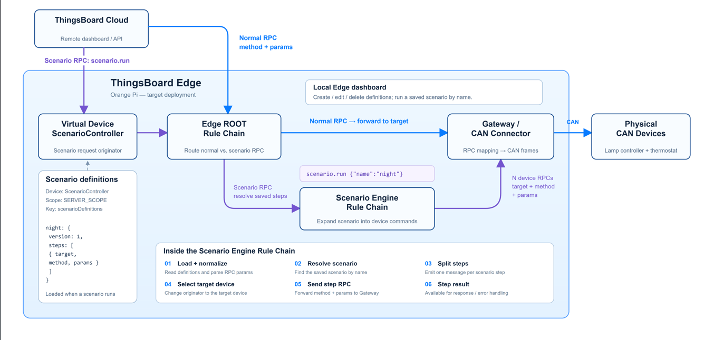

# Four local-processing architectures: comparative evaluation

This is a **side-by-side evaluation of four approaches that were explored and tested during the internship**. It does not crown a universal winner. Architecture 04 was experimentally exercised but **did not achieve a stable deployment on the tested Orange Pi Zero 3**; its source/exported rules have not yet been supplied for this public snapshot. Architectures 01–03 have source snapshots here, with intentionally anonymized hardware-specific details.

The comparison is based on the **implementation descriptions, figures, and experimental observations in the internship report**. There is no uniform numerical benchmark of latency, CPU load, power, reliability, or cost across all four candidates. Advantages and disadvantages below are therefore *design trade-offs and reported observations*, not independently measured competitive scores.

## Shared engineering problem

The underlying system combines CAN-equipped smart-home devices, a Linux gateway, ThingsBoard telemetry and RPC, and the ability to run local device-control scenarios without always reaching a central server. The CAN Connector and its converters are central to three designs; the parallel design deliberately opens an additional direct-CAN route. A scenario such as *Night* is decomposed into device-targeted commands, but **where that decomposition runs** and **how those commands reach the bus** differ.

## 01 — Parallel local processing through SocketCAN



```text
CAN bus (can0)
  |
  +--> ThingsBoard Gateway --> ThingsBoard Server
  |
  +--> Local Processor
         |-- CAN protocol
         |-- Device models
         |-- Scenario Engine
         `--> MQTT Bridge (separate)
```

**What was tried:** independent SocketCAN sockets on the same interface; layered interface/protocol/device code; local lamp controls, thermostat functions and a Scenario Engine; a separate ThingsBoard MQTT bridge.

**Strengths**
- Local control follows a direct path to CAN and does not require a Gateway RPC round trip.
- A separate local process can be developed and tested independently of Gateway internals.
- The local processor is conceptually lightweight and its layers expose the device protocol explicitly.

**Limitations**
- Both Gateway and Local Processor interpret CAN traffic; duplicated protocol and device mapping code can drift.
- A separate MQTT bridge adds another server-facing integration path and potential state coordination concerns.
- Independent components need their own arbitration/coordination when issuing commands to the same physical devices.
- Keeping the Gateway alongside the Local Processor creates redundancy, which can be read in two ways: it can improve fault tolerance, but it also makes the Gateway less central to the system.

**Potentially suitable when:** minimizing coupling to Gateway or preserving independent CAN access matters more than a single centralized translation path.

## 02 — Gateway-integrated local processing



```text
CAN bus <--> CAN Connector / Converters <--> ThingsBoard Gateway <--> ThingsBoard
                                                      |
                                                      |  Gateway state hooks + local RPC
                                                      |  (Unix domain socket IPC)
                                                      |
                                               Local Processor
```

**What was tried:** exposing already-converted device state from Gateway, local RPC injection into the existing downlink path, host/container communication through a shared Unix-domain socket, and a Python local client/scenario process.

**Strengths**
- Centralizes CAN protocol translation in the Gateway's CAN Connector/converters.
- Local logic sees device names, state, methods and parameters instead of raw frames.
- Reuses the existing RPC-to-CAN path rather than introducing independent CAN sending logic.

**Limitations**
- Requires changes to upstream ThingsBoard Gateway service and telemetry/RPC integration points.
- Those modifications must be reviewed and maintained as Gateway versions change.
- Gateway and Local Processor require carefully configured IPC endpoints, shared filesystem paths and authentication.

**Potentially suitable when:** the organization controls its Gateway distribution, accepts maintaining a custom upstream patch, and values centralized device protocol ownership.

## 03 — Scenario Connector and gRPC Local Processor



```text
Telemetry: CAN -> CAN Connector -> Uplink Converter -> ThingsBoard
                                       |
                                 in-process queue
                                       |
                                Scenario Connector --gRPC--> Local Processor

Commands: Local Processor -> gRPC command polling -> Scenario Connector
                -> existing CAN Connector RPC handler -> Downlink Converter -> CAN
```

**What was tried:** a dedicated Scenario Connector, gRPC between container and host, a Local Processor with state storage and scenario orchestration, and a GTK UI. Within this candidate, an earlier Event Bus/custom CAN Connector route was also investigated; the later source uses a simpler queue and dispatches local RPC through the original CAN Connector.

**Strengths**
- Keeps raw CAN and CAN conversion inside the Gateway, while keeping local business logic in a separate service.
- Extension points avoid the broad service-level patching of approach 02.
- A separate gRPC interface allows more than one local client type, including the GTK UI.

**Limitations**
- Introduces queues, gRPC, a host service, and related startup/recovery/observability concerns.
- The Connector still interacts with Gateway/CAN Connector APIs that can vary between versions.
- The in-process queue in this public snapshot is reconstructed and not durable; it may drop telemetry when full and has not been device-in-the-loop validated here.

**Potentially suitable when:** maintainable module boundaries and local application flexibility matter, and the team can operate the additional interprocess components.

## 04 — ThingsBoard Edge and local Rule Chains



```text
Remote ThingsBoard server (when connected)
                    ^
             ThingsBoard Edge
     Root Rule Chain -> Scenario Engine Rule Chain
                    |
            device-targeted RPC
                    |
       Gateway / CAN Connector -> CAN bus
```

**What was tried:** an Edge-based scenario design using a virtual Scenario Controller, server-side attributes for scenario definitions, routing through Root and Scenario Engine Rule Chains, resource-reduction experiments, and installation attempts on the Orange Pi Zero 3 with Gateway running.

**Strengths**
- Reuses ThingsBoard's local rule-engine and RPC model for orchestration.
- Avoids requiring a separately implemented Python Scenario Engine in the conceptual design.
- May fit teams already deploying and administering ThingsBoard environments with sufficient edge hardware.

**Limitations**
- The report describes substantial memory demands: the initial assessment was around 1.3 GB, while available free memory on the tested board was about 700 MB; a tuned 600 MiB container test consumed nearly its entire limit, in addition to other services.
- On the tested Orange Pi Zero 3, swapping, slowdown, and crashes prevented stable joint operation with Gateway despite tuning and local/non-container attempts.
- Its export files, configuration and executable implementation are **not yet present in this public repository**; the experiment is documented from the report.

**Potentially suitable when:** hardware resources and ThingsBoard operational expertise can support a local Edge instance. The tested low-memory board outcome warrants an early feasibility test.

## Cross-architecture comparison

| Selection criterion | 01 · Parallel SocketCAN | 02 · Gateway-integrated | 03 · Scenario Connector | 04 · ThingsBoard Edge |
|---|---|---|---|---|
| CAN access | Both Gateway and Local Processor | Gateway | Gateway | Gateway |
| Local scenario logic | Python Local Processor | Python Local Processor | Python Local Processor | Local Rule Chains |
| Local command path | Direct CAN send | Gateway local RPC | gRPC → Scenario Connector → Gateway RPC | Edge RPC → Gateway |
| High-level CAN decode shared with local logic | Duplicated | Shared from Gateway | Shared from Gateway | Gateway decoding for Edge telemetry |
| Changes to Gateway core | Not required for separate local route | **Required** in tested design | Custom connector/converter, not broad core patch | Not a goal of conceptual design |
| Additional integration burden | Separate MQTT bridge + CAN clients | Unix IPC + customized Gateway | Queue + gRPC + host/container networking | Edge runtime + Rule Chains + operational services |
| Reported hardware experience | Lightweight local prototype | Gateway plus local host process | Gateway plus local host process | **Unstable on tested Orange Pi Zero 3** |
| Material available in this repository | Source (redacted protocol fields) | Host source + one customized upstream service file | Source + custom connector and UI | **Evaluation/README only; files to follow** |

**Not measured consistently:** latency, deterministic command timing, CPU and energy consumption, availability percentages, total cost of ownership, and security posture. These cannot be inferred from architecture drawings alone.

## Choosing according to organizational requirements

A choice should follow the team's **resource envelope**, **CAN ownership model**, **upgrade/maintenance responsibilities**, **ability to operate additional services**, and **existing ThingsBoard expertise**. Different priorities can legitimately lead to different choices:

- **Independent low-level CAN control is essential:** investigate **01**, while budgeting for duplicated protocol work and coordinated commands.
- **Single point of CAN translation is essential and custom Gateway maintenance is acceptable:** investigate **02**.
- **Modular separation between Gateway and local application is the priority:** investigate **03**, while validating the extension APIs and IPC failure behavior.
- **Native ThingsBoard automation and integration outweigh embedded resource limits:** investigate **04**, after verifying Edge stability on the organization's actual hardware.

Use the **[organizational selection worksheet](organization-selection-guide.md)** to document priorities and validation results rather than declaring one option universally optimal.
